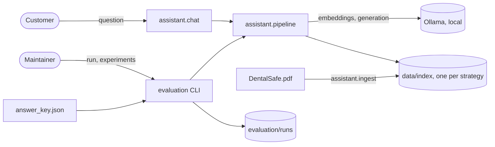

# RagLab documentation

RagLab is a local RAG assistant plus the bench that measures it. The built-in example is the virtual assistant of DentalSafe, a fictional dental clinic, which answers customer questions from a 3-page brochure.

**Stack:** Python 3.14 · LangChain 1.x · Chroma · rank-bm25 · Ollama (`llama3`, `nomic-embed-text`) · pytest · **Status:** working prototype, published as a portfolio project

## Documentation map

| Document | Answers |
|---|---|
| [Product](product.md) | What RagLab does, for whom, its features, and the glossary |
| [Business rules](business-rules.md) | What the assistant must and must not say, how an answer is scored, and what makes an answer key or a run valid |
| [Architecture](architecture.md) | Stack, components, data files, the Ollama integration, risks |
| [RAG pipeline](rag-pipeline.md) | The whole path of a question, from the PDF to the scored answer |
| [Development](development.md) | How to run, test, and do the common tasks |
| [Decisions](decisions/README.md) | Why the project is built this way (5 ADRs) |
| [Evaluation manual](../evaluation/README.md) | Every evaluation command and how to read the scoreboard |
| [Project guide](project-guide.html) | A visual walk-through of the same content, for a first read |

## One-screen view

- The assistant answers only from the brochure; when the brochure has no answer, it replies with one fixed sentence.
- The chat and the evaluation call the same two functions, `retrieve()` and `answer()`, so what is measured is what the customer gets.
- An answer is scored without a model: values are extracted from the text and compared with the answer key.
- Current results: 96.1% on 51 working questions, 90.5% on 21 reserved ones, against 15.7% for the project's starting point. See the [root README](../README.md#results).
- Everything runs locally. No data leaves the machine and no API key is needed.

## Open questions

- [ ] The answer key was written by an AI assistant from the brochure and has not been reviewed by a person. Is every expected fact what the maintainer would accept?
- [ ] The judge has not been checked against human labels (`evaluation/data/human_labels.json` is unfilled). Until then its scores are not trustworthy.
- [ ] The prompt asks for at most 3 sentences and a closing invitation to schedule, but only the length in characters is checked. Should these two become deterministic checks? See [inconsistencies](business-rules.md#inconsistencies-found).
- [ ] The repository has no license file. Under which license is it published?
- [ ] Is RagLab meant to stay a single-example project, or to be split into a generic core plus examples? The code is specific to DentalSafe today (see [risks](architecture.md#risks-and-technical-debt)).

---
Last updated: 2026-10-11 (3bb132c)
