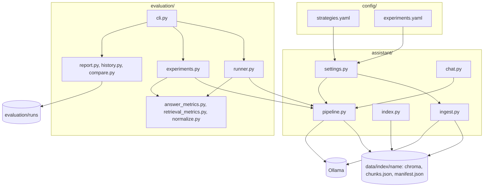

# Architecture

## Stack

| Layer | Technology | Version | Note |
|---|---|---|---|
| Language | Python | 3.14 | No build step; run as modules (`python -m ...`) |
| Models | Ollama | local server | `llama3` for chat and judge, `nomic-embed-text` for embeddings; both replaceable through `.env` |
| Orchestration | langchain-core, langchain-ollama | 1.6.9, 1.1.0 | Used for prompt templates and the model clients only; there are no chains or agents |
| Vector store | Chroma (langchain-chroma) | 1.1.0 | One persistent collection per chunking strategy |
| Word-based search | rank-bm25 | 0.2.2 | Built in memory from `chunks.json` at first use |
| PDF | pypdf | 6.20.0 | Text extraction, page by page |
| Chunking | langchain-text-splitters | 1.1.3 | Recursive splitter for the character strategy and for oversized sections |
| Configuration | PyYAML, jsonschema, python-dotenv | 6.0.3, 4.26.0, 1.2.4 | YAML validated against JSON Schema, with messages that say what to fix |
| Terminal output | rich | 15.0.0 | Scoreboard tables and progress bars |
| Tests | pytest | 9.1.1 | Unit tests run with no model; integration tests are marked and skipped by default |

Versions come from [requirements.txt](../requirements.txt).

## Components



The dependency runs one way: `evaluation` imports `assistant`, never the other way round.

## Code organization

```text
config/         the two files a maintainer edits, and their schemas
assistant/      the assistant: configuration, ingestion, index state, search and answer, chat
evaluation/     answer key, scoring, bench, history, reports, judge, and the command line
  data/           answer_key.json and the judge's human-label sample
  schemas/        JSON Schema of the answer key and of a stored run
  runs/           reference runs, baseline.json, and experiment CSV files
tests/
  unit/           one file per module; no model needed
  integration/    the real assistant, with Ollama and the indexes
  fixtures/       example answers with the verdict the scoring must give
data/
  source/         the brochure
  index/          generated, not in git
docs/           this documentation
```

## Interface

RagLab has no graphical interface. It has two command-line entry points:

- **Chat**, [chat.py](../assistant/chat.py): a loop that reads a question, streams the answer, and exits on `exit` or `quit`. It refuses to start when the configuration is invalid (exit code 2) or the index is missing or out of date (exit code 1).
- **Evaluation**, [cli.py](../evaluation/cli.py): `argparse` subcommands (`run`, `experiments`, `retrieval`, `compare`, `baseline`, `list`, `kb-check`, `validate`, `calibrate`). Every handler returns 0 on success, 1 on a runtime error such as a missing model, and 2 on a usage or configuration error. Output is drawn by [report.py](../evaluation/report.py).

[run.ps1](../run.ps1) and the [Makefile](../Makefile) give the same 15 short names to these commands; a unit test keeps the two files in step.

## Data

There is no database server. Everything is a file.

| File | Written by | Holds |
|---|---|---|
| `data/index/<strategy>/chroma/` | `assistant.ingest` | Embeddings of the chunks |
| `data/index/<strategy>/chunks.json` | `assistant.ingest` | The same chunks as text, for the word-based search |
| `data/index/<strategy>/manifest.json` | `assistant.ingest` | Hash of the strategy definition, hash of the PDF, embedding model, chunk count; decides whether the index is current ([BR-IDX-01](business-rules.md#br-idx-01--an-out-of-date-index-is-refused)) |
| [evaluation/data/answer_key.json](../evaluation/data/answer_key.json) | the maintainer | Questions, expected facts, evidence. Format: [schema](../evaluation/schemas/answer_key.schema.json) |
| `evaluation/runs/<id>/run.json` | `evaluation run` | Configuration snapshot, every answer with its retrieved chunks, metrics. Format: [schema](../evaluation/schemas/run.schema.json) |
| `evaluation/runs/<id>/report.md` | `evaluation run` | The scoreboard and every question, readable without tools |
| `evaluation/runs/baseline.json` | `evaluation baseline set` | Which run is the reference of each subset |
| `evaluation/runs/experiments/*.csv` | `evaluation experiments` | One summary and one per-question file per round |
| `evaluation/data/human_labels.json` | `evaluation calibrate export` | Sample of answers for a person to label |

The vector base and `chunks.json` must hold the same chunks; `kb-check` reports any difference.

A stored run records the git commit and whether the tree was dirty, plus hashes of the prompt and of the chunks, so two runs can be told apart by what actually changed.

## Integration: Ollama

The only external service, and it is local.

| Used for | Client | Where |
|---|---|---|
| Embeddings | `OllamaEmbeddings`, wrapped by `PrefixedEmbeddings` | [ingest.py](../assistant/ingest.py) |
| Chat and HyDE | `ChatOllama` | [pipeline.py](../assistant/pipeline.py) |
| Judge | `ollama.Client().chat` with a JSON schema | [judge.py](../evaluation/judge.py) |
| Listing installed models | `ollama.Client().list` | `preflight` in [runner.py](../evaluation/runner.py) |

Configuration, all optional, from `.env` (template in [.env.example](../.env.example)): `OLLAMA_BASE_URL`, `OLLAMA_CHAT_MODEL`, `OLLAMA_EMBEDDING_MODEL`, `OLLAMA_JUDGE_MODEL`.

Not obvious:

- `nomic-embed-text` expects a prefix that says whether a text is a document or a query. `PrefixedEmbeddings` adds it, and only for that model.
- The chat model is kept loaded for 30 minutes (`KEEP_ALIVE`), and the evaluation asks one warm-up question, so load time is not measured.
- If Ollama is down or a model is not installed, `preflight` reports it before any question is asked.

## Cross-cutting concerns

- **Configuration errors** are collected and reported together, each with the file, the item, and what to fix ([settings.py](../assistant/settings.py)).
- **Interrupted runs** keep what finished and are stored apart ([BR-RUN-01](business-rules.md#br-run-01--incomplete-runs-stay-out-of-the-history)).
- **Caching**: the Chroma client, the BM25 index, the chunk vectors, and the model clients are cached per process with `lru_cache` in [pipeline.py](../assistant/pipeline.py). A long-running process does not see a rebuilt index until it restarts.

## Decisions

See [decisions/](decisions/README.md).

## Risks and technical debt

- **The model can be talked out of its role.** All three wrong answers across the 72 questions are of this kind (stating its source twice, answering as a pirate once). A prompt cannot guarantee behaviour; a check on the output could.
- **Results are sensitive to small prompt changes.** Three prompt versions in a row scored the same 96.1% with different wrong questions. One or two questions of difference are noise.
- **Section detection is a heuristic.** `is_heading` in [ingest.py](../assistant/ingest.py) recognizes headings by capitalized words and no digits or colon. A brochure with another layout can be chunked wrong without any error; `kb-check` is the safety net.
- **The search vocabulary is hand-written for this brochure.** `STOPWORDS` and `QUERY_SYNONYMS` in [config.py](../assistant/config.py) were tuned on the working questions. The reserved questions guard against overfitting, but there are only 21 of them.
- **A private Chroma attribute is used.** `_vectors` in [pipeline.py](../assistant/pipeline.py) and `load_kb` in [kb_checks.py](../evaluation/kb_checks.py) read `db._collection`, which may change between library versions.
- **The example is not separable.** The PDF path, the prompt, the synonyms, the intro-section suffix, and the answer key are DentalSafe-specific and spread over [config.py](../assistant/config.py) and [pipeline.py](../assistant/pipeline.py).
- **The judge is unverified.** It gave 5.9% for conciseness to one- and two-sentence answers; nobody has labelled the sample yet.
- **No CI.** Tests run only when someone runs them.
