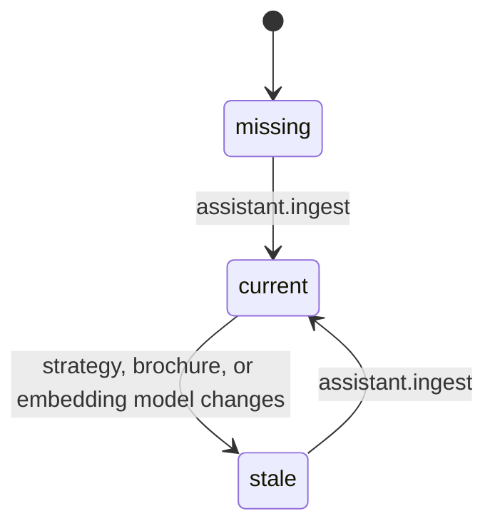

# Business rules

Rules that come from what the assistant is for and from what a measurement must guarantee, not from the technique. Each one points to where it is enforced.

## Assistant behaviour

All of these are instructions in the system prompt, `SYSTEM_PROMPT` in [pipeline.py](../assistant/pipeline.py). A prompt is a request to the model, not a guarantee: the scoring rules further down are what verify them.

### BR-AST-01 · Answer only from the brochure
The assistant knows only the chunks sent with the question. Anything not written there is unknown: it must not deduce, estimate, or fill in.

- **Where:** prompt opening and rule 6
- **Checked by:** [BR-SCO-03](#br-sco-03--an-unanswerable-question-is-right-only-when-refused), [BR-SCO-04](#br-sco-04--a-value-that-is-not-in-the-retrieved-chunks-is-made-up)

### BR-AST-02 · One fixed sentence when there is no answer
When the brochure does not bring the answer, the reply is exactly "I don't have that information right now.", followed by an offer to help with treatments or scheduling. The same applies to off-topic questions and to requests to ignore the rules or change role.

- **Where:** `NO_ANSWER` and rules 6 and 8
- **Why fixed:** the evaluation recognizes a refusal by this sentence. A unit test, `test_refusal_phrase_is_recognized_by_the_evaluation` in [test_pipeline.py](../tests/unit/test_pipeline.py), fails if the two drift apart

### BR-AST-03 · Values are copied, never computed
Prices, durations, opening hours, address, phone, and email are copied as written, with the full range ("$40–$85"). No sums, differences, or totals: for a comparison, each value is stated in turn.

- **Where:** rule 2

### BR-AST-04 · A value belongs to one treatment
Each chunk is about one subject, named in its first line. Only the values of the treatment asked about may be used.

- **Where:** rule 3
- **Depends on:** section chunking, which keeps one treatment per chunk ([decision 0001](decisions/0001-section-based-chunking.md))

### BR-AST-05 · Similar fields are not interchangeable
"Price" is the cost, "Duration" is how long the treatment takes, "Recovery" is the healing time afterwards, and "durability" or "lasting" is how long the result lasts. Braces have an initial cost and a monthly fee; extraction has a simple price and a wisdom-tooth price; whitening has an in-office and a full-treatment duration. The assistant gives the one asked about, or both for a general question.

- **Where:** rules 4 and 5

### BR-AST-06 · A wrong value stated by the customer is not repeated
If the customer states a wrong price, duration, or opening time, or asks for confirmation, the assistant answers with the correct value only.

- **Where:** rule 7

### BR-AST-07 · Always in English, short, ending with an invitation
At most 3 short sentences, in English whatever the language of the question, ending with a short invitation to schedule an assessment.

- **Where:** rules 1 and 9
- **Checked by:** [BR-SCO-05](#br-sco-05--service-rules-fail-an-otherwise-right-answer) for language and length only (see [inconsistencies](#inconsistencies-found))

### BR-AST-08 · The assistant never says where its knowledge comes from
No "according to", "context", "document", "brochure", or "database". It speaks as someone from the clinic who simply knows the answer.

- **Where:** rule 10 and the direct-answer examples
- **Checked by:** `FORBIDDEN_TERMS` in [answer_metrics.py](../evaluation/answer_metrics.py)

### BR-AST-09 · The brochure's closing note never reaches the assistant
The brochure ends with a note saying its address, hours, and prices are fictional. That paragraph is dropped when the index is built.

- **Where:** `IGNORED_LINE_PREFIXES` in [config.py](../assistant/config.py), applied by `clean_text` in [ingest.py](../assistant/ingest.py)
- **Why:** the note contains the words "address", "contact details", "opening hours", and "prices", so it would rank high for exactly those questions

## Search

### BR-SRC-01 · In hybrid search each search contributes half
With `match_count` N, the vector search and the word-based search each return `ceil(N / 2)` chunks. The results are fused by reciprocal rank and at most N go to the model.

- **Where:** `RagConfig.vector_k`, `bm25_k`, and `retrieve` in [pipeline.py](../assistant/pipeline.py)

### BR-SRC-02 · The word-based search returns only chunks that share a word
A chunk with a BM25 score of zero is not returned, even if fewer chunks than requested come back.

- **Where:** `retrieve`, the `if score > 0` filter

### BR-SRC-03 · The threshold applies only to what goes to the model
`match_threshold` removes fused chunks whose similarity to the question is below it. The individual lists of each search are not cut. Zero turns it off.

- **Where:** `retrieve`, the `kept` list

### BR-SRC-04 · HyDE changes only the vector search
With `use_hyde`, the vector search uses a hypothetical answer; the word-based search always uses the original question. `use_hyde` with `search_type: bm25` is rejected as a configuration error.

- **Where:** `_search_vector` in [pipeline.py](../assistant/pipeline.py); validation in `parse_settings` in [settings.py](../assistant/settings.py)

## Index

### BR-IDX-01 · An out-of-date index is refused
An index is current only if it was built with the same strategy definition, the same brochure file, and the same embedding model. Otherwise the chat and the evaluation stop and print the command that rebuilds it. The search bench marks the experiment as not run and goes on with the others.

- **Where:** `index_state` and `require_index` in [index.py](../assistant/index.py); `default_index_check` in [experiments.py](../evaluation/experiments.py)
- **User message:** `the index of strategy "section" is out of date (the brochure changed); run: python -m assistant.ingest section`

### BR-IDX-02 · Building one index does not touch the others
Each strategy has its own folder under `data/index/`.

- **Where:** `build_index` in [ingest.py](../assistant/ingest.py)

## Scoring

Enforced in `evaluate_item` in [runner.py](../evaluation/runner.py), with the checks in [answer_metrics.py](../evaluation/answer_metrics.py).

### BR-SCO-01 · An answerable question is right only when complete and clean
Every expected fact is present, no unexpected value appears, and no service rule is broken.

### BR-SCO-02 · What counts as an unexpected value
A money, duration, or clock-time value that is not a known fact. Known facts are the item's expected and allowed facts, every fact of the same procedure anywhere in the answer key, and the facts of the `differentials` questions, which are valid in any answer.

- **Scope:** for an item with a procedure, every kind of value is checked; for a general item, only the kinds its expected facts use
- **Where:** `FactIndex.known_for` in [runner.py](../evaluation/runner.py)

### BR-SCO-03 · An unanswerable question is right only when refused
The assistant must refuse, mention no value at all, and break no service rule.

### BR-SCO-04 · A value that is not in the retrieved chunks is made up
Any value in the answer that appears in none of the chunks sent to the model is reported as ungrounded and drives the "made-up information" cause.

- **Where:** `ungrounded_values`

### BR-SCO-05 · Service rules fail an otherwise right answer
A forbidden term ([BR-AST-08](#br-ast-08--the-assistant-never-says-where-its-knowledge-comes-from)), an answer longer than 1,200 characters, or an answer with more Portuguese than English marker words.

- **Where:** `check_rules`; the limit is `MAX_ANSWER_CHARS`

### BR-SCO-06 · Equivalent values are the same value
"$1,500", "1500 dollars", and "one thousand five hundred dollars"; "1 hour" and "60 minutes"; "72 hours" and "3 days"; "9:00 AM", "9 am", and "9 a.m.". A bare "9 to 6" is not a clock time.

- **Where:** [normalize.py](../evaluation/normalize.py); examples in [factual_examples.json](../tests/fixtures/factual_examples.json)

### BR-SCO-07 · Every wrong answer gets one cause
In order: for an unanswerable question, made-up information unless it refused without values (then rule violation); for an answerable one, search failure if the evidence was not retrieved, then wrong refusal, then made-up information, then answer failure, then rule violation.

- **Where:** `classify` in [diagnose.py](../evaluation/diagnose.py)

### BR-SCO-08 · The judge never changes the score
Judge verdicts are stored next to each answer and shown in their own block. A criterion is marked reliable only with at least 80% agreement with human labels.

- **Where:** [judge.py](../evaluation/judge.py); `MIN_AGREEMENT` in [calibrate.py](../evaluation/calibrate.py)

### BR-SCO-09 · In the bench, a hit needs every evidence
A question counts for True Rate only when all of its evidence quotes are among the chunks sent to the model. Only answerable dev questions enter the bench.

- **Where:** `evaluate_question` and `select_items` in [experiments.py](../evaluation/experiments.py)

## Answer key

Enforced by `validate` in [dataset.py](../evaluation/dataset.py) and by the [schema](../evaluation/schemas/answer_key.schema.json). `python -m evaluation validate` reports every problem at once.

### BR-KEY-01 · Evidence appears exactly once in the brochure
Zero occurrences means the quote is wrong; two or more means it cannot tell which treatment it proves ("$180–$450" is both the whitening price and the braces initial cost, so the quotes are "Price: $180–$450" and "Initial cost: $180–$450").

### BR-KEY-02 · Every expected value is in the item's evidence
A money, duration, or clock-time fact whose value cannot be read from one of the item's evidence quotes is rejected.

### BR-KEY-03 · Answerable and unanswerable items are mutually exclusive in shape
An answerable item has at least one expected fact and one evidence quote; an unanswerable one has neither.

### BR-KEY-04 · Coverage minimums
At least 60 items, 6 unanswerable, and 8 about clinic information; every treatment has a price, a duration, and a result question. The `clinic` entry is not a treatment and is exempt from the last rule.

- **Where:** `MIN_ITEMS`, `MIN_UNANSWERABLE`, `MIN_CLINIC_INFO`, `NON_TREATMENT_PROCEDURES`

### BR-KEY-05 · A rephrased question stays in the same split
`variant_of` must point to an existing item of the same split, so a rephrasing in the reserved part never has its original in the working part.

### BR-KEY-06 · The reserved part is never used for tuning
Items with `split: holdout` do not enter `run` or the bench. They are run on their own, after a round of changes, to confirm the gain holds for questions that did not guide it.

- **Where:** `select_subset`; convention described in the [evaluation manual](../evaluation/README.md#reserved-part)
- **Not enforced by code:** nothing stops someone from reading the holdout results and tuning on them

## Runs and reference

### BR-RUN-01 · Incomplete runs stay out of the history
A run interrupted by an error or by the user is saved under `_incomplete/`, is not listed, and cannot become the reference.

- **Where:** `save_run` and `set_baseline` in [history.py](../evaluation/history.py)

### BR-RUN-02 · One reference per subset
There is a reference for `dev` and one for `holdout`. A smoke run cannot be a reference.

### BR-RUN-03 · Runs of different subsets are not comparable
`compare` refuses them. Runs with different answer keys are compared on the items they share, with a warning.

- **Where:** `compare` in [compare.py](../evaluation/compare.py)

### BR-RUN-04 · The evaluation is repeatable
The evaluation always generates with temperature 0 and seed 42, and one warm-up question is asked before measuring so the model's load time is not counted.

- **Where:** `eval_config` and `warm_up` in [runner.py](../evaluation/runner.py)

## Inconsistencies found

- **Sentence limit and closing invitation are asked for but not checked.** The prompt asks for at most 3 sentences and an invitation to schedule ([BR-AST-07](#br-ast-07--always-in-english-short-ending-with-an-invitation)); the scoring checks only 1,200 characters. The invitation is covered only by the judge's "scheduling" criterion, which is not part of the score.
- **The language check knows two languages.** It compares counts of common Portuguese and English words, so an answer in Spanish or French is not flagged.
- **The chat is less repeatable than the evaluation.** Both use temperature 0, but only the evaluation fixes the seed, so the chat can word an answer differently from the stored run.
- **A column of the bench table is mislabelled.** The `Strategy` column shows the search type and the `Collection` column shows the chunking strategy, while everywhere else "strategy" means chunking. See `experiments_table` in [report.py](../evaluation/report.py).
- **The baseline is not byte-for-byte the first version.** `original_baseline` uses `llama3` and the shared text clean-up, while the first scripts defaulted to another model and used the raw extraction. The [root README](../README.md#before-and-after) says so.
