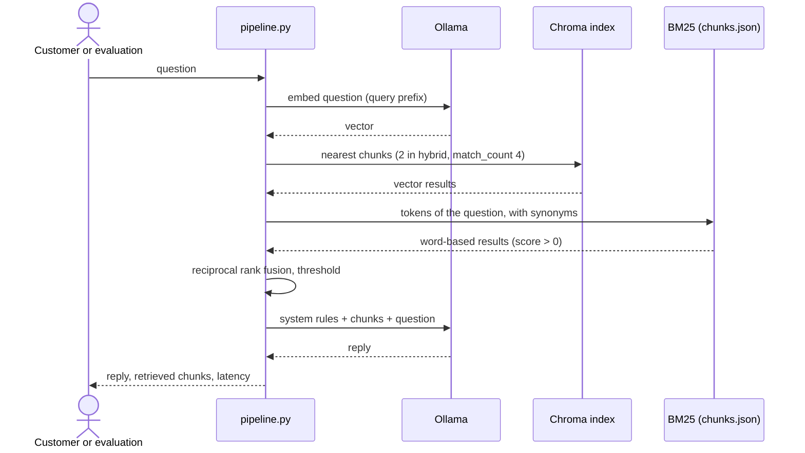

# RAG pipeline

The pipeline is what RagLab exists to demonstrate and measure: how a question becomes an answer, and how that answer becomes a score. This document tells that story end to end and links to the rules and decisions instead of repeating them.

## Overview

| Stage | When | Code | Output |
|---|---|---|---|
| Ingestion | Once per brochure or strategy change | [ingest.py](../assistant/ingest.py) | One index per strategy |
| Retrieval | Every question | `retrieve` in [pipeline.py](../assistant/pipeline.py) | Up to `match_count` chunks |
| Generation | Every question | `answer` / `stream_answer` in [pipeline.py](../assistant/pipeline.py) | The reply |
| Scoring | Evaluation only | [runner.py](../evaluation/runner.py) and the metrics modules | Right or wrong, with a cause |

## End-to-end flow



### 1. Ingestion

1. **Read**: `load_pages` extracts the text of each page with pypdf.
2. **Clean**: `clean_text` drops the running page header, turns list markers into `- item`, and drops the paragraphs listed in `IGNORED_LINE_PREFIXES` ([BR-AST-09](business-rules.md#br-ast-09--the-brochures-closing-note-never-reaches-the-assistant)). It runs for every strategy, so comparing strategies measures only the chunking.
3. **Chunk**, according to the strategy type:
   - `section`: `split_sections` starts a new chunk at each heading. The opening block of the brochure, which has the address, hours, and contact but no heading, becomes "DentalSafe — Clinic Information". A section larger than `max_chars` is split, with the title repeated in each part.
   - `split`: recursive character splitting of the whole text.
   - `page`: one chunk per page.
4. **Store**: `save_chunks` writes `chunks.json`, `vectorize_chunks` rebuilds the Chroma collection, and `write_manifest` records what the index was built from.

With the current brochure the section strategy yields 11 chunks: the clinic block, 8 treatments, "Why Choose DentalSafe?", and "Schedule Your Assessment Today".

### 2. Retrieval

The search follows the experiment named in the `assistant:` line of [experiments.yaml](../config/experiments.yaml), currently `section_hybrid`.

1. **Query vector**: the question is embedded once and normalized. With HyDE, the model first writes a hypothetical answer and that text is embedded instead ([BR-SRC-04](business-rules.md#br-src-04--hyde-changes-only-the-vector-search)).
2. **Vector search**: nearest chunks in Chroma.
3. **Word-based search**: `tokenize` lower-cases, removes stop words and the plural "s", and, for the question only, adds the brochure's wording for the customer's ("cost" also searches "price", "where" also searches "location"). BM25 ranks the chunks.
4. **Fusion**: reciprocal rank fusion with the usual constant 60, so a chunk well placed in both searches beats the first of only one ([BR-SRC-01](business-rules.md#br-src-01--in-hybrid-search-each-search-contributes-half)).
5. **Threshold**: optional cut by similarity ([BR-SRC-03](business-rules.md#br-src-03--the-threshold-applies-only-to-what-goes-to-the-model)).

`retrieve` returns three lists, `vector`, `bm25`, and `fused`, each chunk with its rank, its own score, and its cosine similarity to the query. Only `fused` goes to the model; the other two exist so the evaluation can show what each search contributed.

### 3. Generation

`build_prompt` puts the rules in a system message and, in the user message, the chunks separated by `---` followed by the question. The rules are the ones in [assistant behaviour](business-rules.md#assistant-behaviour). The model runs with temperature 0 and at most 200 output tokens.

An experiment with `prompt: original` uses the single-message prompt the project started with instead. It exists only for the `original_baseline` experiment.

### 4. Scoring

For each item of the answer key, `evaluate_item`:

1. Checks the **search**: was each evidence quote among the chunks, at which rank, and in a chunk that also names the treatment ([retrieval_metrics.py](../evaluation/retrieval_metrics.py)).
2. Checks the **answer**: extracts money, durations, and clock times from the reply ([normalize.py](../evaluation/normalize.py)) and applies the [scoring rules](business-rules.md#scoring).
3. Assigns a **cause** when wrong ([BR-SCO-07](business-rules.md#br-sco-07--every-wrong-answer-gets-one-cause)).
4. Optionally asks the **judge**, which never changes the result.

[aggregate.py](../evaluation/aggregate.py) turns the per-question results into the scoreboard.

## Two ways to measure

| | `evaluation experiments` | `evaluation run` |
|---|---|---|
| Measures | The search only | The answer, and the search behind it |
| Calls the chat model | No (except for HyDE) | Yes |
| Questions | Answerable dev questions (44) | The chosen subset (51 in dev) |
| Takes | Seconds | About half a minute without the judge |
| Use it to | Choose chunking and search | Confirm a change before adopting it |

The bench does not see what the model replies. Two experiments with the same True Rate can produce answers of different quality, which is why a change is confirmed with `run --experiment NAME`.

## Edge cases

- **No chunk matches a word of the question**: the word-based list is empty and the vector results go alone.
- **The threshold removes everything**: the model receives "(no information found for this question)" and should refuse.
- **The index is missing or out of date**: nothing runs ([BR-IDX-01](business-rules.md#br-idx-01--an-out-of-date-index-is-refused)).
- **Ollama stops in the middle of an evaluation**: the run is stored as incomplete with what finished ([BR-RUN-01](business-rules.md#br-run-01--incomplete-runs-stay-out-of-the-history)).
- **The question is in another language**: retrieval still works when the vector search finds the chunk; the reply must be in English.
- **A treatment with two prices or two durations**: the prompt asks for the one in question, or both ([BR-AST-05](business-rules.md#br-ast-05--similar-fields-are-not-interchangeable)); the answer key lists the sibling value in `allowed_facts`.

## How to verify

```powershell
python -m assistant.ingest                 # section: 11 chunks
python -m evaluation kb-check              # 0 duplicates, 0 unanchored facts, 0 corrupted chunks
python -m evaluation validate              # valid configuration and answer key
python -m evaluation experiments           # section_hybrid 44/44
python -m evaluation run --no-judge        # 98.0% of 51, compared with the reference
python -m evaluation run --no-judge --experiment original_baseline   # 29.4% of 51
```

The numbers are those of the stored runs in `evaluation/runs/`; a different model version can move them by a question or two.

## See also

- Rules: [assistant behaviour](business-rules.md#assistant-behaviour), [search](business-rules.md#search), [scoring](business-rules.md#scoring)
- Decisions: [section chunking](decisions/0001-section-based-chunking.md), [hybrid search](decisions/0002-hybrid-search-with-query-synonyms.md), [deterministic scoring](decisions/0003-deterministic-scoring.md)
- Commands and scoreboard: [evaluation manual](../evaluation/README.md)
